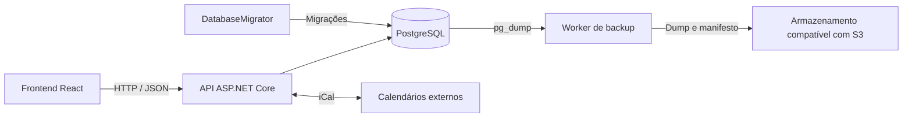

# DevInn

DevInn é um sistema de gestão de reservas para pousadas e pequenos hotéis. Em um só painel, a equipe consulta a ocupação por quarto, calcula o preço de uma estadia, registra reservas e acompanha receitas e despesas.

[Rodar localmente](#desenvolvimento-local) · [Explorar a demonstração](#roteiro-da-demonstração) · [Ver a arquitetura](#arquitetura)

## O que o DevInn faz

| Módulo | Funcionalidades |
| --- | --- |
| Reservas | Calendário de ocupação, consulta de disponibilidade, cadastro de reservas e comprovantes em PDF. |
| Inventário | Cadastro de quartos e categorias, capacidade de ocupação e regras de preço para hóspedes adicionais e crianças. |
| Financeiro | Registro e categorização de despesas, acompanhamento de receitas e despesas e atualização do status de conciliação das reservas. |
| Integrações | Importação de reservas de feeds iCal e exportação da disponibilidade de cada quarto por iCal. |
| Administração | Gestão de múltiplas pousadas, com perfis de administração global e por pousada. |

## Desenvolvimento local

O [guia de desenvolvimento](docs/desenvolvimento-local.md) mostra como rodar o frontend, a API e o PostgreSQL em Windows, macOS ou Linux. Você vai precisar de Git, Node.js 24+, pnpm 10+, SDK do .NET 10 e Docker.

A interface roda em `http://localhost:5173` e a documentação interativa da API fica em `http://localhost:5109/scalar`.

## Roteiro da demonstração

1. Entre com a conta local `innadmin@pousada.local` seguindo o [guia de desenvolvimento](docs/desenvolvimento-local.md#explore-os-dados-de-demonstração).
2. Abra o **Calendário** e avance pelas próximas semanas para encontrar as reservas de exemplo no quarto 101.
3. Crie uma reserva para um período livre e confira como a ocupação afeta o preço antes de salvar. Abra a reserva para gerar o comprovante.
4. Na área **Financeiro**, registre uma despesa de exemplo e confira os gráficos de receitas e despesas.

## Arquitetura



| Componente | Responsabilidade |
| --- | --- |
| [Frontend](apps/web/README.md) | Aplicação em React, TypeScript, Vite, Tailwind CSS e shadcn/ui. Usa TanStack Query para consultar a API. |
| [API](apps/api/src) | API REST em ASP.NET Core. Organiza regras de negócio em `Domain`, casos de uso em `Application`, persistência e integrações em `Infrastructure` e endpoints em `WebApi`. |
| [Migrador](apps/api/src/DevInn.DatabaseMigrator) | Executa as migrações do banco da aplicação e do esquema de identidade em um processo separado. |
| [Worker de backup](apps/backup/README.md) | Gera e valida dumps lógicos do PostgreSQL, envia os arquivos para armazenamento compatível com S3 e aplica retenção. |

A API usa ASP.NET Core Identity e JWT para autenticação. Os acessos administrativos usam papéis distintos e as consultas de dados operacionais são feitas no contexto da pousada. A persistência combina EF Core com consultas SQL via Dapper. A sincronização periódica de iCal usa Quartz quando os jobs estão habilitados. A API e o worker emitem telemetria via OpenTelemetry.

## Build e testes

Execute na raiz do repositório após instalar as dependências.

```sh
pnpm --filter @dev-inn/web lint
pnpm --filter @dev-inn/web build
dotnet test --solution apps/api/DevInn.slnx
dotnet test --solution apps/backup/DevInn.Backup.slnx
```

O GitHub Actions executa lint e build do frontend e compila e testa as soluções .NET.

## Contribuição

Abra uma issue para discutir uma mudança ou relatar um bug. Envie pull requests para `main` com uma descrição e os testes realizados. Inclua exatamente um marcador de versão entre `[Patch]`, `[Minor]` e `[Major]` no título ou no corpo do PR. Siga as [convenções do repositório](AGENTS.md).

## Licença

O código do DevInn é distribuído sob a [Apache License 2.0](LICENSE).
