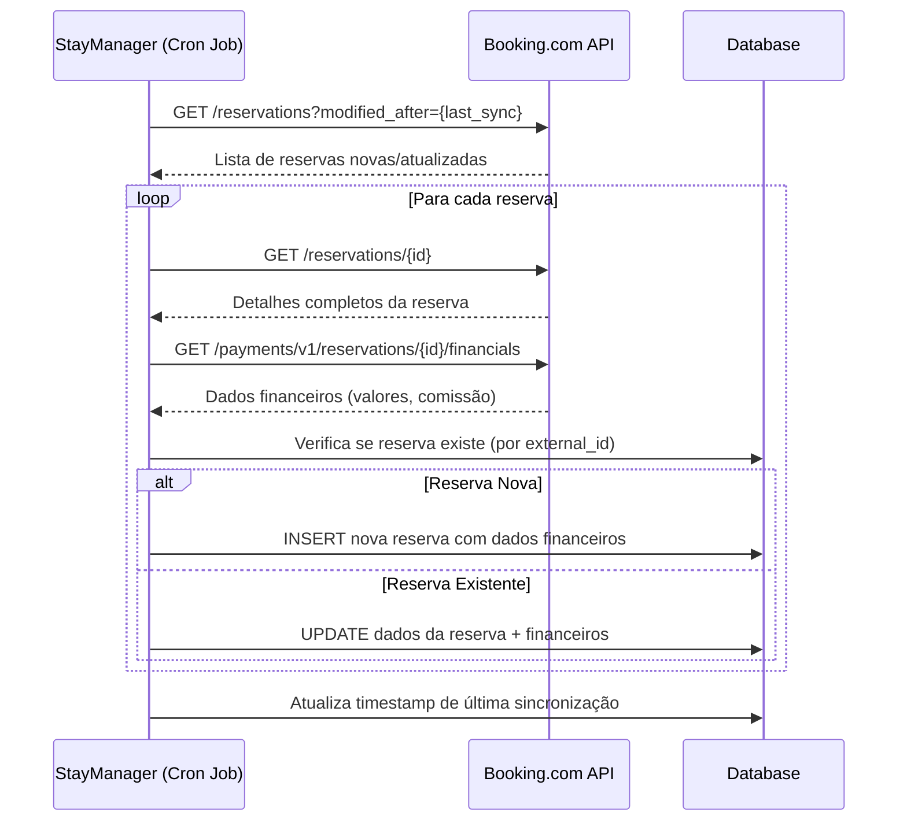
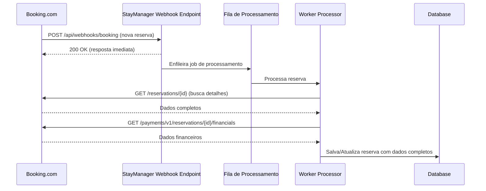
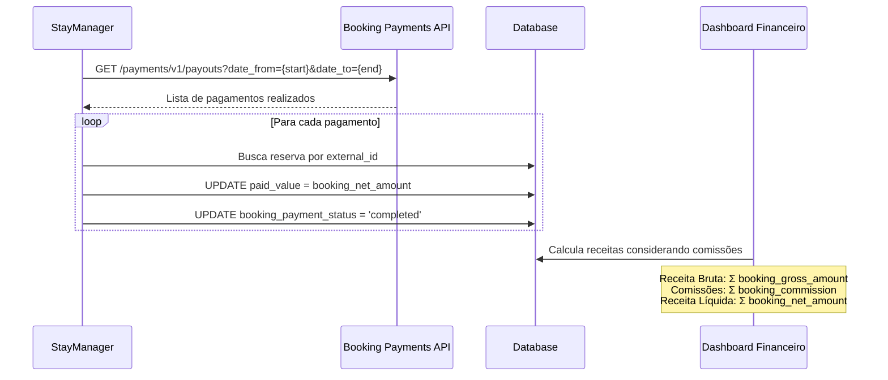

# Especificação Técnica de Integração - Booking.com Connectivity API

**Versão:** 1.0
**Data:** Janeiro 2026
**Responsável:** Equipe de Desenvolvimento
**Relacionado:** [PRD - Sistema de Gestão de Hospedagem](./PRD.md)

---

## 1. Visão Geral da Integração

### 1.1 Objetivo
Integrar o **StayManager** com a **Booking.com Connectivity API** para sincronização bidirecional de:
- Reservas (pull de novas reservas e atualizações)
- Valores financeiros (diárias, taxas e comissões do Booking.com)
- Disponibilidade e preços (push de inventário)
- Status de reservas (confirmações, cancelamentos, modificações)

### 1.2 Tipo de Integração
- **API Utilizada:** Booking.com Connectivity APIs
- **Arquitetura:** REST API com autenticação OAuth 2.0
- **Documentação Oficial:** https://developers.booking.com/connectivity/home
- **Ambiente:** Produção + Sandbox (testes)

### 1.3 Benefícios de Negócio
- ✅ Eliminação de digitação manual de reservas do Booking.com
- ✅ Transparência financeira: valores brutos, líquidos e comissões
- ✅ Prevenção de overbooking via sincronização de disponibilidade
- ✅ Atualização automática de status (confirmado, cancelado, no-show)

---

## 2. Soluções Implementadas (Connectivity APIs)

### 2.1 Foundational Solutions (Obrigatórias para MVP)

#### **Reservations API** (Prioridade Alta)
Sincronização de reservas criadas no Booking.com para o StayManager.

**Funcionalidades:**
- **Pull de Reservas:** Buscar novas reservas e atualizações
- **Webhook de Notificações:** Receber notificações em tempo real de novas reservas
- **Detalhes Completos:** Nome do hóspede, datas, contato, valores

**Endpoints principais:**
```
GET /reservations/v1/reservations
GET /reservations/v1/reservations/{reservation_id}
POST /webhook (receber notificações push)
```

#### **Payments API** (Prioridade Alta)
Obtenção de informações financeiras detalhadas sobre cada reserva.

**Funcionalidades:**
- Valor total cobrado do hóspede
- Valor líquido que a pousada receberá
- Taxa/comissão do Booking.com
- Método de coleta de pagamento (Booking.com ou propriedade)

**Endpoints principais:**
```
GET /payments/v1/reservations/{reservation_id}/financials
GET /payments/v1/payouts
```

#### **Rates and Availability API** (Prioridade Média)
Envio de preços e disponibilidade do StayManager para o Booking.com.

**Funcionalidades:**
- Atualizar preços por data e tipo de quarto
- Bloquear datas indisponíveis
- Definir restrições (estadia mínima, check-in/out)

**Endpoints principais:**
```
POST /rates-availability/v1/availability
POST /rates-availability/v1/rates
```

---

## 3. Mapeamento de Dados: Booking.com → StayManager

### 3.1 Entidade: Reservation

#### Dados Recebidos do Booking.com
```json
{
  "reservation_id": "12345678",
  "hotel_id": "987654",
  "booker": {
    "first_name": "João",
    "last_name": "Silva",
    "email": "joao.silva@email.com",
    "phone": "+55 37 99888-7766"
  },
  "check_in": "2026-02-15",
  "check_out": "2026-02-20",
  "number_of_rooms": 1,
  "room": {
    "room_id": "101",
    "room_name": "Chalé Deluxe",
    "number_of_adults": 2,
    "number_of_children": 1,
    "children_ages": [7]
  },
  "status": "confirmed",
  "created_at": "2026-01-10T14:30:00Z",
  "modified_at": "2026-01-10T14:30:00Z"
}
```

#### Mapeamento para Booking (StayManager)
```typescript
{
  id: generateUUID(),
  inn_id: getUserInnFromHotelId(booking_data.hotel_id),
  room_id: mapRoomIdToLocalRoom(booking_data.room.room_id),
  guest_name: `${booking_data.booker.first_name} ${booking_data.booker.last_name}`,
  phone: booking_data.booker.phone,
  email: booking_data.booker.email,
  check_in: booking_data.check_in,
  check_out: booking_data.check_out,
  adults: booking_data.room.number_of_adults,
  children: booking_data.room.number_of_children,
  children_ages: booking_data.room.children_ages,
  source: 'booking_api',
  cancellation_status: booking_data.status === 'cancelled',
  external_id: booking_data.reservation_id, // Referência para o ID do Booking
  created_at: booking_data.created_at,
  updated_at: booking_data.modified_at
}
```

### 3.2 Entidade: Financial Data (Payments API)

#### Dados Recebidos do Booking.com
```json
{
  "reservation_id": "12345678",
  "currency": "BRL",
  "gross_amount": 2500.00,          // Valor total cobrado do hóspede
  "net_amount": 2125.00,             // Valor líquido para a propriedade
  "commission_amount": 375.00,       // Comissão do Booking (15%)
  "commission_percentage": 15.0,     // Percentual de comissão
  "payment_type": "booking_collect", // Quem coleta: booking_collect | property_collect
  "payment_status": "pending",       // Status: pending | completed | refunded
  "payout_date": "2026-02-22",       // Data prevista de pagamento
  "breakdown": {
    "accommodation": 2000.00,
    "extras": 500.00,                // Extras (café da manhã, etc)
    "taxes": 0.00
  }
}
```

#### Extensão da Entidade Booking (StayManager)
```typescript
// Adicionar campos à tabela Booking:
{
  // ... campos existentes ...

  // Campos financeiros da integração:
  booking_gross_amount: 2500.00,      // Gross amount
  booking_net_amount: 2125.00,        // Net amount (após comissão)
  booking_commission: 375.00,         // Commission amount
  commission_percentage: 15.0,        // Commission percentage
  collection_method: 'booking_collect',  // booking_collect | property_collect
  booking_payment_status: 'pending',  // pending | completed | refunded
  expected_payout_date: '2026-02-22',

  // Breakdown (opcional, pode ser JSON)
  extras_breakdown: 500.00,

  // Override valores locais com valores do Booking
  total_value: 2500.00,  // Usa booking_gross_amount
  paid_value: 0.00       // Atualizado quando booking_payment_status = 'completed'
}
```

---

## 4. Fluxos de Integração

### 4.1 Fluxo de Sincronização de Reservas (Pull)



**Frequência recomendada:** A cada 5-10 minutos

### 4.2 Fluxo de Webhook (Push - Tempo Real)



**Eventos suportados:**
- `reservation.created` - Nova reserva
- `reservation.modified` - Alteração de reserva
- `reservation.cancelled` - Cancelamento

### 4.3 Fluxo de Atualização Financeira



**Frequência recomendada:** Diariamente às 6h da manhã

---

## 5. Configuração de Autenticação

### 5.1 OAuth 2.0 Flow

```javascript
// 1. Registro no Provider Portal
// URL: https://connect.booking.com/
// Obter: client_id, client_secret

// 2. Solicitar Access Token
POST https://oauth.booking.com/token
Content-Type: application/x-www-form-urlencoded

grant_type=client_credentials
&client_id={YOUR_CLIENT_ID}
&client_secret={YOUR_CLIENT_SECRET}
&scope=reservations:read payments:read rates:write

// 3. Response
{
  "access_token": "eyJhbGciOiJIUzI1NiIsInR5cCI6IkpXVCJ9...",
  "token_type": "Bearer",
  "expires_in": 3600
}

// 4. Usar token nas requisições
GET https://api.booking.com/reservations/v1/reservations
Authorization: Bearer {access_token}
```

### 5.2 Armazenamento de Credenciais

**Tabela: integration_credentials**
```sql
CREATE TABLE integration_credentials (
  id UUID PRIMARY KEY,
  inn_id UUID NOT NULL REFERENCES inn(id),
  provider VARCHAR(50) NOT NULL, -- 'booking_com'
  hotel_id VARCHAR(100),         -- ID da propriedade no Booking
  client_id VARCHAR(255) ENCRYPTED,
  client_secret VARCHAR(255) ENCRYPTED,
  access_token TEXT ENCRYPTED,
  token_expires_at TIMESTAMP,
  refresh_token TEXT ENCRYPTED,
  is_active BOOLEAN DEFAULT true,
  last_sync_at TIMESTAMP,
  created_at TIMESTAMP DEFAULT NOW(),
  updated_at TIMESTAMP DEFAULT NOW(),

  UNIQUE(inn_id, provider)
);
```

---

## 6. Campos Adicionais no Banco de Dados

### 6.1 Extensão da Tabela `booking`

```sql
ALTER TABLE booking ADD COLUMN IF NOT EXISTS external_id VARCHAR(100);
ALTER TABLE booking ADD COLUMN IF NOT EXISTS source VARCHAR(50);
ALTER TABLE booking ADD COLUMN IF NOT EXISTS booking_gross_amount DECIMAL(10,2);
ALTER TABLE booking ADD COLUMN IF NOT EXISTS booking_net_amount DECIMAL(10,2);
ALTER TABLE booking ADD COLUMN IF NOT EXISTS booking_commission DECIMAL(10,2);
ALTER TABLE booking ADD COLUMN IF NOT EXISTS commission_percentage DECIMAL(5,2);
ALTER TABLE booking ADD COLUMN IF NOT EXISTS collection_method VARCHAR(50);
ALTER TABLE booking ADD COLUMN IF NOT EXISTS booking_payment_status VARCHAR(50);
ALTER TABLE booking ADD COLUMN IF NOT EXISTS expected_payout_date DATE;
ALTER TABLE booking ADD COLUMN IF NOT EXISTS extras_breakdown DECIMAL(10,2);

CREATE INDEX idx_booking_external_id ON booking(external_id);
CREATE INDEX idx_booking_source ON booking(inn_id, source);
```

### 6.2 Nova Tabela: `booking_sync_log`

```sql
CREATE TABLE booking_sync_log (
  id UUID PRIMARY KEY DEFAULT gen_random_uuid(),
  inn_id UUID NOT NULL REFERENCES inn(id),
  sync_type VARCHAR(50), -- 'pull', 'webhook', 'financial'
  status VARCHAR(50),    -- 'success', 'error', 'partial'
  reservations_processed INTEGER DEFAULT 0,
  reservations_created INTEGER DEFAULT 0,
  reservations_updated INTEGER DEFAULT 0,
  error_message TEXT,
  started_at TIMESTAMP NOT NULL,
  completed_at TIMESTAMP,
  created_at TIMESTAMP DEFAULT NOW()
);

CREATE INDEX idx_sync_log_date ON booking_sync_log(inn_id, created_at DESC);
```

---

## 7. Interface de Usuário (Configurações)

### 7.1 Tela de Configuração de Integração

**Localização:** Configurações > Integrações > Booking.com

**Campos:**
```
┌─────────────────────────────────────────────┐
│  Integração Booking.com                      │
├─────────────────────────────────────────────┤
│                                              │
│  Status: ● Conectado                         │
│  Última sincronização: há 5 minutos          │
│                                              │
│  ┌─────────────────────────────────────┐    │
│  │ Hotel ID no Booking.com              │    │
│  │ [987654________________]             │    │
│  └─────────────────────────────────────┘    │
│                                              │
│  ┌─────────────────────────────────────┐    │
│  │ Client ID                            │    │
│  │ [abc123xyz_______________]           │    │
│  └─────────────────────────────────────┘    │
│                                              │
│  ┌─────────────────────────────────────┐    │
│  │ Client Secret                        │    │
│  │ [●●●●●●●●●●●●●●●●●●●●]  👁️         │    │
│  └─────────────────────────────────────┘    │
│                                              │
│  [ Testar Conexão ]  [ Sincronizar Agora ]  │
│                                              │
│  ───────────────────────────────────────    │
│                                              │
│  Configurações Avançadas                     │
│  ☑ Sincronizar automaticamente a cada 10min │
│  ☑ Receber webhooks em tempo real           │
│  ☑ Importar valores e comissões             │
│  ☐ Enviar disponibilidade automaticamente   │
│                                              │
│  URL do Webhook (copiar):                   │
│  https://app.staymanager.com/api/webhooks/  │
│  booking/123e4567-e89b                      │
│                                              │
└─────────────────────────────────────────────┘
```

### 7.2 Indicadores Visuais nas Reservas

**No calendário e lista de hóspedes:**
- Badge "📘 Booking" para reservas importadas
- Tooltip com valores financeiros detalhados:
  ```
  Valor Bruto: R$ 2.500,00
  Comissão (15%): -R$ 375,00
  ──────────────────────────
  Você Recebe: R$ 2.125,00

  Status: Pagamento Pendente
  Previsão: 22/02/2026
  ```

---

## 8. Tratamento de Erros e Edge Cases

### 8.1 Conflitos de Dados

| Cenário | Tratamento |
|---------|-----------|
| Quarto do Booking não existe no sistema | Criar alerta para admin mapear quarto manualmente |
| Reserva modificada no Booking após check-in | Atualizar apenas campos permitidos (não alterar datas) |
| Cancelamento no Booking de reserva já hospedada | Marcar como cancelada mas manter histórico |
| Valores divergentes após sincronização | Priorizar valores do Booking, logar discrepância |

### 8.2 Retry e Resiliência

```javascript
// Estratégia de retry exponencial
const retryConfig = {
  maxRetries: 3,
  initialDelay: 1000,  // 1s
  backoffMultiplier: 2,
  maxDelay: 10000      // 10s
};

// Exemplo de implementação
async function fetchWithRetry(url, options, retries = 0) {
  try {
    return await fetch(url, options);
  } catch (error) {
    if (retries < retryConfig.maxRetries) {
      const delay = Math.min(
        retryConfig.initialDelay * Math.pow(retryConfig.backoffMultiplier, retries),
        retryConfig.maxDelay
      );
      await sleep(delay);
      return fetchWithRetry(url, options, retries + 1);
    }
    throw error;
  }
}
```

### 8.3 Rate Limiting

- **Limite da API:** 100 requisições/minuto
- **Estratégia:** Implementar queue com throttling
- **Monitoramento:** Logar headers `X-RateLimit-Remaining`

---

## 9. Dashboard Financeiro com Dados do Booking

### 9.1 Métricas Específicas

**Card adicional no Dashboard Financeiro:**
```
┌─────────────────────────────────────┐
│  📊 Análise Booking.com              │
├─────────────────────────────────────┤
│  Receita Bruta:     R$ 12.500,00     │
│  Comissões:        -R$  1.875,00     │
│  ────────────────────────────────    │
│  Receita Líquida:   R$ 10.625,00     │
│                                      │
│  Taxa Média: 15%                     │
│  Reservas: 8                         │
└─────────────────────────────────────┘
```

### 9.2 Comparativo por Canal

```
┌──────────────────────────────────────────────┐
│  Receitas por Canal (Janeiro 2026)           │
├──────────────────────────────────────────────┤
│                                              │
│  Diretas (WhatsApp/Telefone)                │
│  ██████████████████ R$ 8.400,00 (40%)       │
│                                              │
│  Booking.com                                 │
│  ██████████████████████████ R$ 10.625,00    │
│  (50% - líquido após comissão)              │
│                                              │
│  Airbnb (iCal)                              │
│  ██████ R$ 2.100,00 (10%)                   │
│                                              │
└──────────────────────────────────────────────┘
```

---

## 10. Checklist de Implementação

### Fase 1: Setup (Semana 1-2)
- [ ] Criar conta no Booking.com Provider Portal
- [ ] Obter credenciais OAuth (client_id, client_secret)
- [ ] Criar tabelas `integration_credentials` e `booking_sync_log`
- [ ] Adicionar campos de integração na tabela `booking`
- [ ] Implementar serviço de autenticação OAuth

### Fase 2: Reservations API (Semana 3-4)
- [ ] Implementar endpoint de webhook
- [ ] Criar job cron de sincronização (pull)
- [ ] Mapear dados Booking → StayManager
- [ ] Criar tela de configuração de integração
- [ ] Testar em ambiente sandbox
- [ ] Adicionar indicadores visuais ("Badge Booking")

### Fase 3: Payments API (Semana 5-6)
- [ ] Implementar busca de dados financeiros
- [ ] Estender modelo de dados com campos financeiros
- [ ] Criar job de sincronização de payouts
- [ ] Adicionar cards no Dashboard Financeiro
- [ ] Implementar tooltip com breakdown de valores
- [ ] Criar relatório de comissões

### Fase 4: Testes e Validação (Semana 7-8)
- [ ] Testes E2E completos
- [ ] Validar tratamento de erros e edge cases
- [ ] Testes de performance (sincronização de 100+ reservas)
- [ ] Documentação interna para suporte
- [ ] Treinamento da equipe
- [ ] Deploy em produção

### Fase 5: Monitoramento (Contínuo)
- [ ] Configurar alertas de falha de sincronização
- [ ] Dashboard de saúde da integração
- [ ] Logs estruturados para debug
- [ ] Métricas de uso (reservas importadas/dia)

---

## 11. Referências e Recursos

- **Documentação Oficial:** https://developers.booking.com/connectivity/docs
- **Provider Portal:** https://connect.booking.com/
- **API Status:** https://connect.booking.com/status
- **Suporte:** Através do Provider Portal (tickets)
- **Sandbox Environment:** Disponível após registro

---

## 12. Próximas Evoluções (Pós-MVP)

1. **Rates & Availability API** - Envio bidirecional de preços e disponibilidade
2. **Messaging API** - Comunicação direta com hóspedes via Booking
3. **Guest Reviews API** - Importação e resposta a avaliações
4. **Market Insights API** - Dados de mercado para precificação dinâmica
5. **Multi-propriedade** - Suporte a múltiplos hotéis de uma mesma pousada

---

**Última atualização:** Janeiro 2026
**Próxima revisão:** Após conclusão da Fase 1
